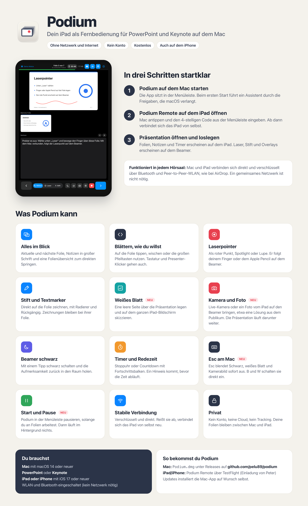

# Podium

Podium macht dein iPad oder iPhone zur Fernbedienung für **PowerPoint** und **Keynote** auf dem Mac: aktuelle und nächste Folie, Moderatornotizen, Timer und Redezeit, Laserpointer, Spotlight, Lupe und Stift direkt auf dem Beamer. Dazu ein weißes Blatt zum Skizzieren und Live-Kamera oder Foto vom iPad über der laufenden Präsentation.

## Mac-App herunterladen

➡️ **[Podium für den Mac (neueste Version)](https://github.com/pelu89/podium/releases/latest/download/Podium.dmg)**

1. `Podium.dmg` öffnen und **Podium** in den Ordner **Programme** ziehen.
2. Podium starten – der Einrichtungsassistent führt durch die nötigen Freigaben.
3. Neue Versionen installiert Podium auf Wunsch selbst (Menüleiste → Podium).

Die App ist von Apple notarisiert und benötigt macOS 14 oder neuer.

## iPad- und iPhone-App

Podium Remote gibt es derzeit als Testversion über **TestFlight** – den Einladungslink bekommst du von Peter.

## Datenschutz

Podium verbindet sich direkt und verschlüsselt mit deinem iPad – ohne Internet, ohne Konto, ohne Tracking.
