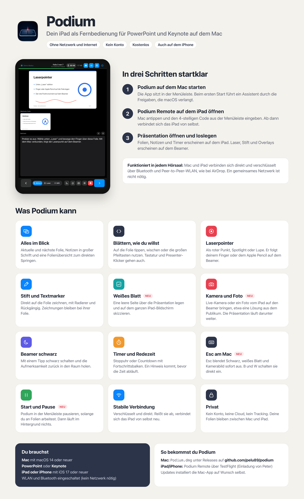

# Podium

**Präsentieren. Ganz einfach.**

Dein iPad oder iPhone steuert **PowerPoint** und **Keynote** auf dem Mac – mit aktueller und nächster Folie, Notizen, Laser, Stift und Timer. Einmal verbinden, dann funktioniert es einfach.

## Mac-App herunterladen

➡️ **[Podium für den Mac (neueste Version)](https://github.com/pelu89/podium/releases/latest/download/Podium.dmg)**

1. `Podium.dmg` öffnen und **Podium** in den Ordner **Programme** ziehen.
2. Podium starten – ein Assistent führt durch die nötigen Freigaben.
3. Neue Versionen installiert Podium auf Wunsch selbst (Menüleiste → Podium).

Von Apple notarisiert. Benötigt macOS 14 oder neuer.

## iPad- und iPhone-App

Podium Remote gibt es derzeit als Testversion über **TestFlight** – den Einladungslink bekommst du von Peter.

## Sicher und privat

Mac und iPad koppeln sich einmal mit einem Code. Danach erkennen sie sich an einem eigenen Schlüssel, der nur auf diesen beiden Geräten liegt, und jede Verbindung wird mit einem frischen Schlüssel verschlüsselt. Kein Internet, kein Konto, keine Cloud, kein Tracking.
